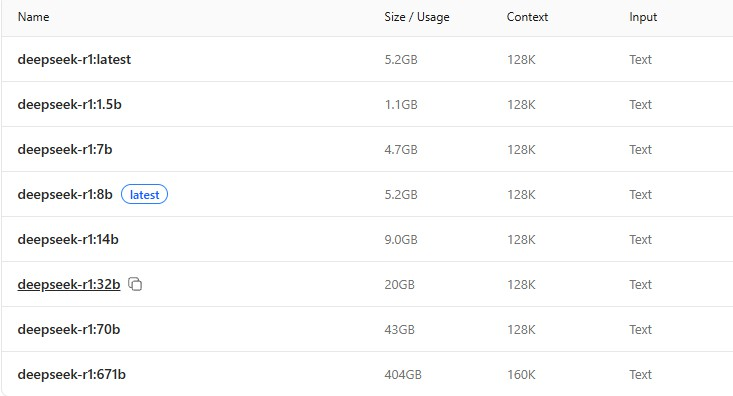

## python-s

### 一、基础

#### 1. 虚拟环境

通过虚拟的运行环境 `.venv`，可以保证每一个 Python 项目都在一个相对独立、隔离的运行环境中运行，项目间互不影响

### 二、高级

### 三、AI应用

#### 1. 本地模型部署

主要是使用 ollama 这个大语言模型管理工具

##### 1.1 ollama 安装

ollama 官网地址：https://ollama.com/

注意：Ollama 默认安装在 C 盘的用户目录。如果不希望安装在 C 盘，就不能直接双击安装，需要通过命令行安装

1）命令行安装

在 OllamaSetup.exe 所在目录打开 cmd，运行：`OllamaSetup.exe /DIR=你要安装的目录位置`

比如：`OllamaSetup.exe /DIR=D:/OllamaDir/Ollama`

2）配置环境变量

安装完成后，还需要配置一个环境变量（新建变量），指定 Ollama 下载和部署模型的位置：

`OLLAMA_MODELS=你想要保存下载的模型的目录`，比如：`OLLAMA_MODELS=D:\OllamaDir\models`

3）替换国内镜像（这一步可选）

Ollama 默认从境外官方仓库拉取模型文件，国内直连链路不稳定、带宽低、容易丢包，关键是网速很慢（随着下载时间，下载速度会越来越慢）

所以我们需要替换为国内镜像源，新建环境变量：`OLLAMA_MODEL_SERVER=https://mirror.ollama.com`

##### 1.2 下载模型

直接去 ollama 的官网找模型，里面有安装的命令，例如：`ollama run deepseek-r1:8b`，直接复制到命令行，会自动下载模型

可以根据自己电脑的配置选择适合的模型，如下图，b 是 billion 的缩写（10亿），1.5b 就是指模型有 15 亿参数，
对应的 size 是模型的存储大小，一般来讲，模型在运行时，所需要的显存往往会大于这个 size 的值，
所以，可以根据自己电脑配置和 size 的大小，大致选出适合自己电脑的模型

满血版的模型就不用想了，下图中 671b 的模型，大概需要 8 张 H200 才能跑的动

